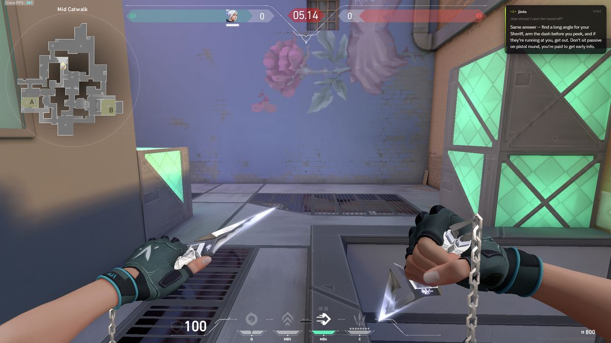
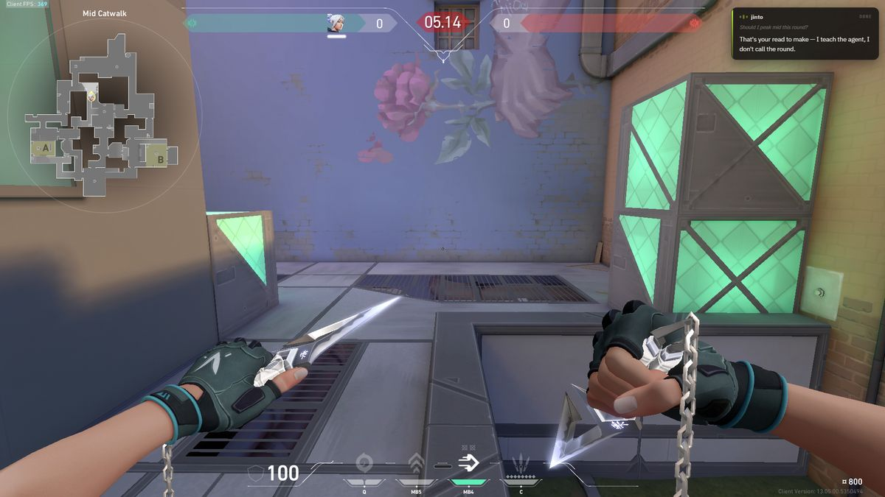
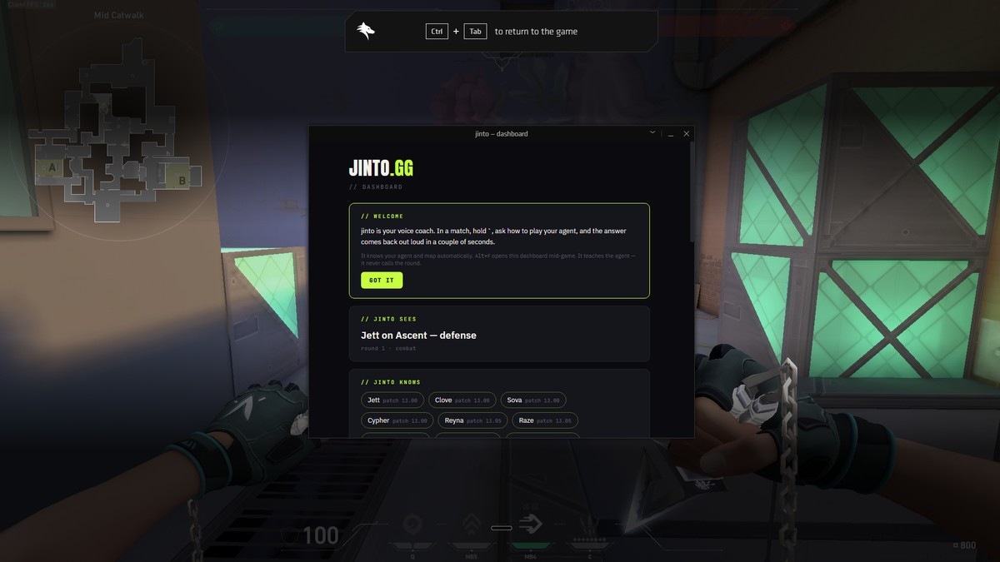

# jinto

A voice coach that runs on top of a live VALORANT match. Hold a key, ask a question out loud,
and hear a spoken answer about two seconds later without ever leaving the game.

> **Status:** feature complete and tested in real matches, not publicly released. Distribution is
> gated on Riot Games third-party approval (application submitted June 2026, still queued) and
> then an Overwolf store review. The site and backend are live at [jinto.gg](https://jinto.gg).



The app knows which agent, map, side and round you are in, so you never tell it anything. It
coaches 11 agents from a knowledge base written and reviewed by hand, and it is built to say "I
don't have that" rather than invent an answer.

It also refuses to play the game for you. Asked where enemies are or whether to push, it declines
by design, which is both a coaching decision and a Riot third-party policy requirement.



---

## How a question flows

Four stages, streamed so the first words arrive before the answer is finished generating.

```
hold `  ──►  microphone capture (MediaRecorder, Opus/WebM)
   │ release
   ▼
speech to text  ──►  Deepgram Nova-3, batch, keyterm boosted
   │ transcript
   ▼
language model  ──►  Claude Sonnet over SSE, one tool call (log_miss)
   │ tokens, flushed at sentence boundaries
   ▼
speech synthesis ──►  Cartesia Sonic-3 over WebSocket, PCM chunks
   │
   ▼
Web Audio playback, gap-free scheduling, plus the on-screen card
```

**Batch speech to text, not streaming.** An earlier build streamed partial transcripts and
misheard short commands badly ("yo" became "nope"). A wrong transcript produces a confidently
wrong coaching answer, which is worse than being slightly slower, so the whole utterance is
transcribed on key release instead. It costs little: that stage measures 294 ms, while the
dominant cost is the model's first token at roughly 1.2 s.

**Sentence-boundary synthesis.** Model tokens are buffered and flushed to the synthesiser only at
sentence boundaries. Flushing on commas made the voice sound stitched together, while whole
sentences keep the prosody natural and still start playback before generation finishes.

---

## Engineering notes

### Latency was measured, not guessed

Every turn records timing marks from key release through microphone flush, transcription, first
model token and first audio. The breakdown is surfaced in an in-app diagnostics panel, so the
optimisation work below came from reading real numbers.

| Stage | Measured |
|---|---|
| Speech to text | 294 ms |
| First model token | 1,222 ms |
| Full model stream | 1,350 ms |
| **Key release to first audio** | **1,823 ms** |

Two changes came out of that data:

**Prompt caching.** The system prompt carries all 11 knowledge documents and runs to 29,885
tokens. It was being reprocessed on every single question. Splitting it into a stable block that
holds the cache breakpoint and a small volatile tail holding round and side means the large
prefix is written once and read back afterwards. The split is positioned deliberately: changing
round or side never invalidates the cache, only switching agents does. Measured against the live
API, a cold call took 4,359 ms and the third cached call took 2,864 ms, a 34% reduction, with the
input tokens billed at cache-read rates instead of full price.

**Warm synthesis socket.** The Cartesia WebSocket handshake costs a few hundred milliseconds per
turn. The connection is now reused across turns, with stale and cancelled-context audio filtered
so reuse cannot leak the previous answer's audio into the next one.

### Stopping the model confusing one agent with another

The worst failure mode in a coaching product is a fluent, confident, wrong answer. Asked about
Jett, the model would reach for Cypher's abilities.

Prompt instructions alone did not hold. The fix is structural rather than instructional: the
current agent's document is injected as the `ACTIVE CORE`, every other agent's document sits
behind an explicit `LOCKED` barrier that only opens when the player names that agent, and an
ability-ownership table maps vocabulary to the kit that owns it. The original failure cases are
now permanent regression questions in the eval suite so the bug cannot return quietly.

### Keys cannot ship inside a desktop app

The client talks to three paid APIs. Shipping an installer means shipping those keys to every
user, so the app runs against a small serverless proxy instead
([source in the jinto.gg repo](https://github.com/moha-arab/jinto.gg)):

| Endpoint | Does |
|---|---|
| `/api/llm` | Streams the model response through. Model and max-token ceiling are pinned server side, so a stolen client key cannot escalate cost. |
| `/api/stt` | Transcription passthrough with fixed server-side parameters. |
| `/api/tts-token` | Mints a 10-minute scoped synthesis token, so the latency-critical audio socket stays client-direct while the real key never leaves the server. |

No provider credential exists in the client.

### A game event that fires exactly once

VALORANT announces your agent to Overwolf at lock-in, once. If the app is not listening at that
instant, for example because it was backgrounded while you loaded in, nothing ever repeats it and
the app sits with no idea who you are playing.

Recovery is bounded and aggressive: on any signal that a match has started, pull a fresh snapshot
immediately and then every 2.5 s until the agent appears, capped at about two minutes. Detection
also degrades honestly, so when the map is known and the agent is not, the app says exactly that
and asks instead of guessing.

---

## Evaluating a system whose output is prose

Unit tests cannot tell you whether coaching advice is good, brief, in character, or correctly
refusing. `cores/battery.js` assembles the exact production prompt, model and tool definitions,
then runs 58 scripted questions across 12 simulated game states: ability mechanics, refusal
balance, cross-agent regression traps, deliberately vague prompts that bait generic filler, and
the agent-select and no-game states. It writes a graded report with an automatic length check.

It runs before any prompt or knowledge change ships. It caught the cross-agent bleed described
above, and a regression where answers grew too long after the prompt was reordered for caching.

It is a regression gate rather than a scored pass/fail suite: the length budget is checked
automatically, the quality judgement is a human reading the report.

---

## The knowledge base

Each agent gets a `cores/<agent>.md` document, around 1,800 words, written against a
[style guide](cores/STYLE.md) that exists so all 11 read as the same coach. 20,120 words total.

The rule that shapes them: the model reasons over these documents and is forbidden from inventing
specifics from its own memory. Map callouts, lineups and exact numbers are the things a language
model will confidently get wrong, so anything not in the documents gets an honest "I don't have
that yet", which is recorded to a miss log visible in the dashboard.

`cores/build.js` compiles the Markdown into self-registering modules that the app loads. Edit the
Markdown, run the build, never edit the generated files.



---

## Running it

Requires [Overwolf](https://www.overwolf.com/) and VALORANT on Windows. There is no build step
and no package manager: the app is plain JavaScript loaded through ordered script tags.

```bash
git clone https://github.com/moha-arab/jinto-app.git
cd jinto-app
cp secrets.example.js secrets.local.js    # then fill it in
```

In proxied mode you only need `APP_KEY`. To run fully standalone, set `enabled: false` in
`scripts/proxy-config.js` and supply your own Deepgram, Anthropic and Cartesia keys.

Then load it in Overwolf: Settings, About, Development options, Load unpacked extension, and
select the repository folder. Hold the backtick key in a match to talk, and Alt+F opens the
dashboard.

After editing any file in `cores/`:

```bash
node cores/build.js      # regenerate the loadable modules
node cores/battery.js    # optional, re-run the eval suite (makes paid API calls)
node build-opk.js        # package an Overwolf .opk installer
```

---

## Repository layout

```
windows/          three Overwolf windows: background, overlay, desktop dashboard
  background/     headless, owns the services and the event bus, runs the pipeline
  overlay/        transparent click-through in-game card, mic-reactive level meter
  desktop/        detection, agent roster, last exchange, miss log, diagnostics
scripts/
  services/       12 modules: capture, playback, the three AI clients, game state, hotkeys
  prompts/        system prompt assembly, including the active/locked core structure
  content/        generated knowledge modules, do not edit by hand
cores/            the knowledge base, its style guide, the build step and the eval harness
build-opk.js      packaging, refuses to build if the app is configured unsafely
```

| Layer | Technology |
|---|---|
| Client | Overwolf Native WebApp, vanilla JavaScript, no dependencies |
| Speech to text | Deepgram Nova-3 |
| Language model | Claude Sonnet, streaming, tool use |
| Speech synthesis | Cartesia Sonic-3 |
| Audio | Web Audio API |
| Backend | Vercel Edge Functions |
| Game data | Overwolf Game Events Provider |

---

## Limitations

- 11 of the game's 29 agents are covered. The rest get an honest refusal rather than a guess.
- Knowledge is map-agnostic. There are no map-specific lineups or callouts yet, by design, since
  those are exactly what a language model fabricates most convincingly.
- The latency figures above come from the app's own instrumentation over a small number of turns,
  not a large sample.
- There are no unit tests. The eval harness is the safety net, and it checks behaviour rather
  than correctness.

---

jinto is not endorsed by Riot Games and does not reflect the views or opinions of Riot Games or
anyone officially involved in producing or managing Riot Games properties. Riot Games, VALORANT
and all associated properties are trademarks or registered trademarks of Riot Games, Inc.
